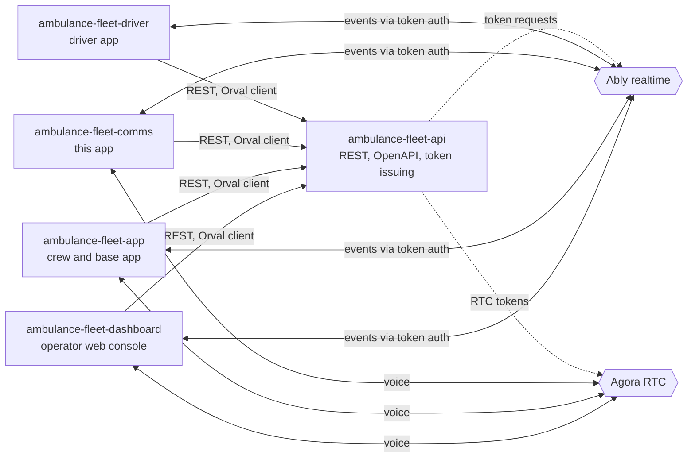
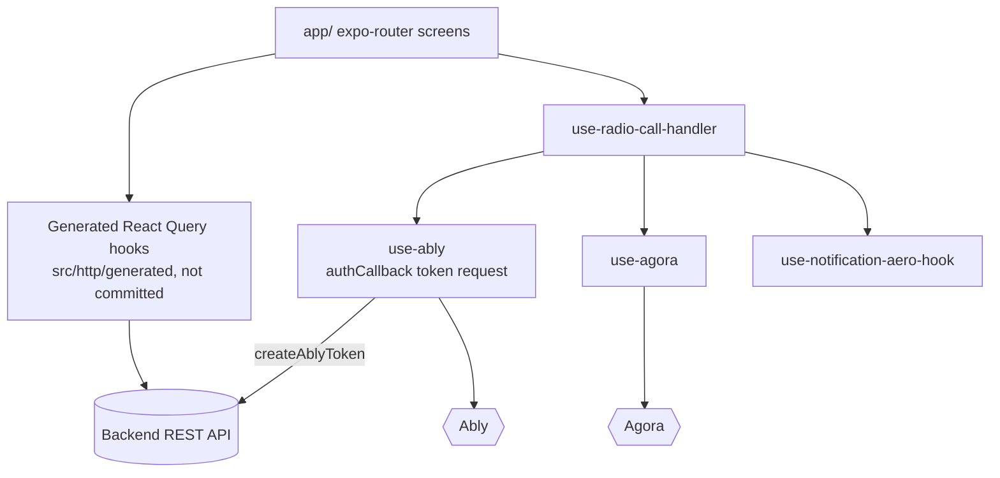
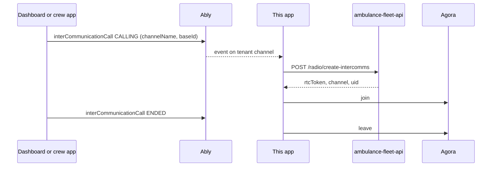

# ambulance-fleet-comms

Expo mobile app for the dispatch-communications role of an ambulance-fleet platform: team chat, push-to-talk radio to bases and notifications over a company channel.

**Status:** prototype client for a separate backend; not claimed to be in production use. No automated tests.

## What it does

- Sign-in as a dispatch user (`/auth/sign-in/comms`) with route guards (`app/public`, `app/protected`, `src/guards`).
- Realtime events over Ably using backend-issued token requests (`src/services/use-ably.ts`).
- Push-to-talk radio over Agora: joins an intercom channel when an Ably `interCommunicationCall` event arrives, and can open a call from the chat screen (`src/services/use-agora.ts`, `src/hooks/use-radio-call-handler.ts`, `app/protected/app/chat.tsx`).
- Answers presence checks (`checkingActiveness`) and plays an alert sound on request (`src/hooks/use-notification-aero-hook.ts`).
- Permissions screen (`src/pages/permissions`).
- API client generated from the backend OpenAPI contract with Orval.

## Architecture

System context:



Inside this app:



Intercom call flow:



Boundaries:

- `app/`: file-based routes, `public/` (sign-in) and `protected/` (chat, permissions).
- `src/services/`: realtime and voice clients behind small hooks, so screens do not import vendor SDKs.
- `src/env/index.ts`: zod-validated environment, fails fast at boot.

## Key engineering decisions and trade-offs

- Ably connections authenticate with backend-issued token requests, one channel per company group (`ambulance-fleet-<companyGroupId>`), rather than a client key (`src/services/use-ably.ts`).
- Event-driven radio: an Ably event triggers a token request and Agora join, and the same hook handles leave (`src/hooks/use-radio-call-handler.ts`).
- Native modules (Agora) require a development build; Expo Go is not enough.

## Tech stack

Expo 54, React Native, Expo Router, NativeWind, TanStack Query, Ably, react-native-agora, expo-audio, zod, Orval.

## Getting started

Prerequisites: Node 20+, Android Studio or Xcode, the API repository checked out next to this one.

```bash
npm install
cp .env.example .env
npx orval               # generates src/http/generated; edit the input path in orval.config.ts first
npx expo prebuild
npm run android         # or: npm run ios
```

| Variable | Purpose |
| --- | --- |
| `EXPO_PUBLIC_BACKEND` | Backend API base URL |
| `EXPO_PUBLIC_APP_VERSION` | Version string used by `app.config.js` |
| `EXPO_PUBLIC_AGORA_APP_ID` | Agora project identifier |

`EXPO_PUBLIC_` values ship inside the app bundle, so never put a secret in them. `orval.config.ts` reads `../ambulance-fleet-api/swagger.json`, so check out the API repository next to this one. The Android background-connection plugin that the original app used was a private local package and is not part of this snapshot, so the app does not run a background keep-alive service.

## Testing

No automated tests; lint with `npm run lint`.

## Project structure

```text
app/        expo-router screens (public, protected)
src/        components, hooks, services (Ably, Agora), pages, guards, env
assets/     images, fonts and sounds
```

## Related repositories

- [ambulance-fleet-api](https://github.com/mkwitko/ambulance-fleet-api): REST API
- [ambulance-fleet-dashboard](https://github.com/mkwitko/ambulance-fleet-dashboard): operator web console
- [ambulance-fleet-app](https://github.com/mkwitko/ambulance-fleet-app): crew and base app
- [ambulance-fleet-driver](https://github.com/mkwitko/ambulance-fleet-driver): driver app

## License

All rights reserved. Source available for portfolio review.
