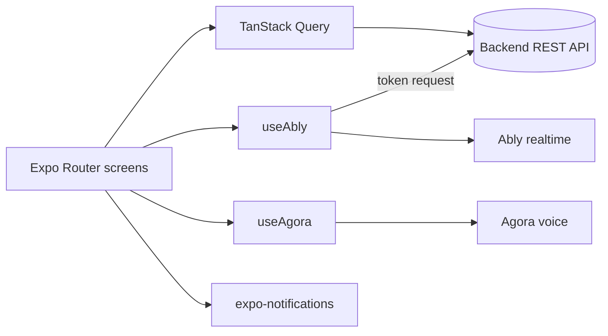

# connect-comms-app

Mobile app (Expo / React Native) for a dispatch-communications role: team chat, push-to-talk radio and notifications over a company channel.

Status: prototype client for a separate backend; not in production use as far as this repository shows. No automated tests.

## What it does

- Sign-in against the backend with role-based route guards.
- Real-time chat over Ably, with short-lived token requests issued by the backend (`src/services/use-ably.ts`).
- Push-to-talk radio over Agora (`src/services/use-agora.ts`, `src/hooks/use-radio-call-handler.ts`).
- Local notifications with a custom sound, background connection service and a permissions screen.
- API client generated from the backend OpenAPI spec with Orval.

## Architecture



- `app/`: file-based routes, `public/` (sign-in) and `protected/` (chat, permissions).
- `src/services/`: realtime and voice clients; `src/http/generated/`: Orval output (not committed; run `npx orval` against a running backend, URL set in `orval.config.ts`).(not committed; run `npx orval` against a running backend, URL set in `orval.config.ts`).
- `src/env/index.ts`: Zod-validated environment.

## Key decisions

- Ably connections authenticate with backend-issued token requests, one channel per company group, rather than a client key.
- Realtime and voice sit behind small hooks so screens do not touch vendor SDKs directly.
- Native modules (Agora) require a development build; Expo Go is not enough.

## Tech stack

Expo 54, React Native, Expo Router, NativeWind, TanStack Query, Ably, Agora, Zod, Orval.

## Getting started

Prerequisites: Node 20+, Android Studio or Xcode.

```bash
npm install
cp .env.example .env
npx expo prebuild
npm run android   # or: npm run ios
```

| Variable | Purpose |
| --- | --- |
| `EXPO_PUBLIC_BACKEND` | Backend API base URL |
| `EXPO_PUBLIC_APP_VERSION` | Version string shown/used by `app.config.js` |
| `EXPO_PUBLIC_ABLY_API_KEY` | Required by the env schema; prefer leaving the real key out and relying on token auth |
| `EXPO_PUBLIC_AGORA_APP_ID` | Agora project identifier |

Never put a production Ably key in an `EXPO_PUBLIC_` variable: those values ship inside the app bundle.

## Testing

No automated tests; lint with `npm run lint`.

## License

All rights reserved. Source available for portfolio review.
